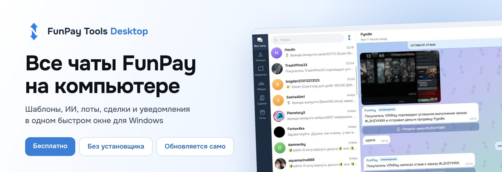
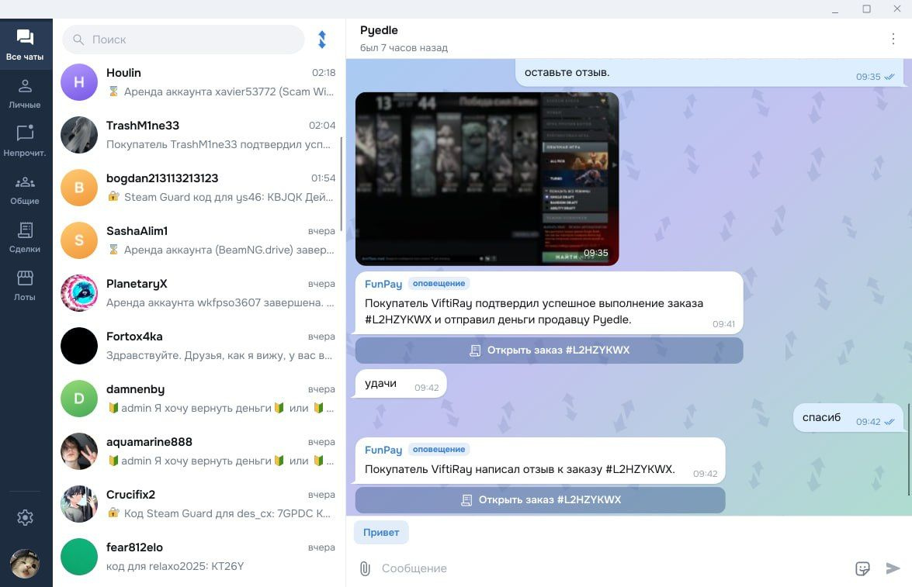
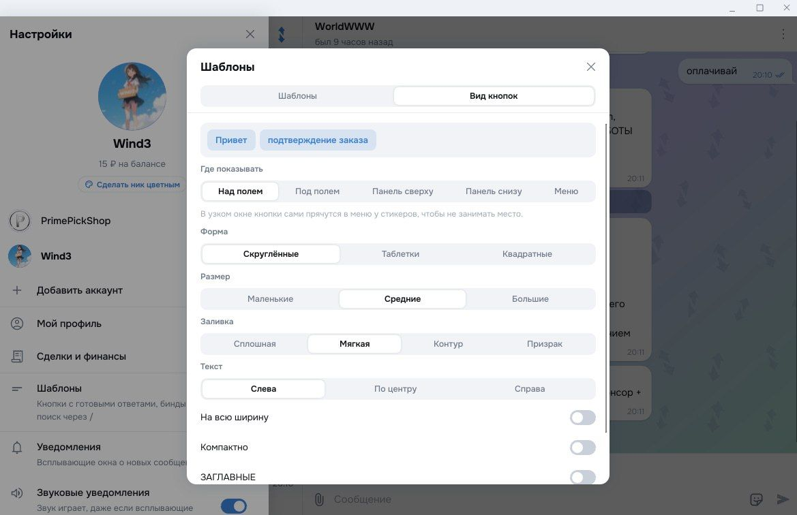
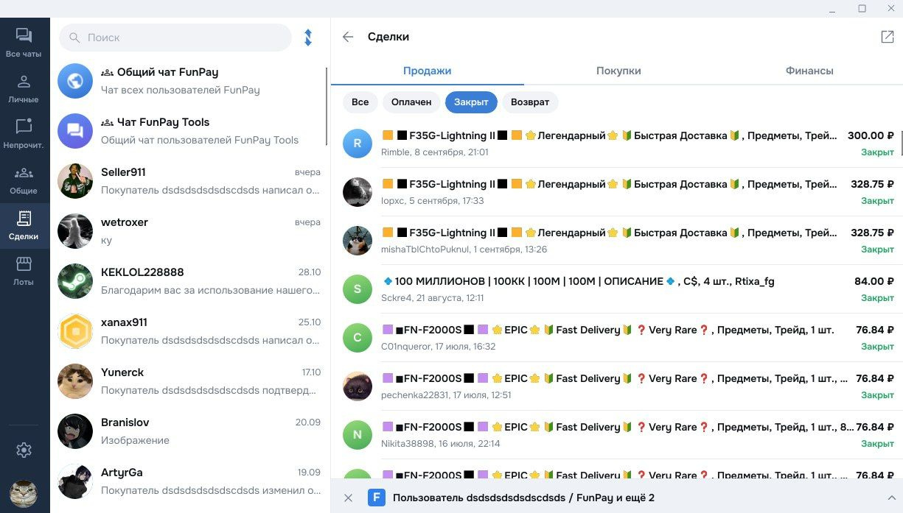
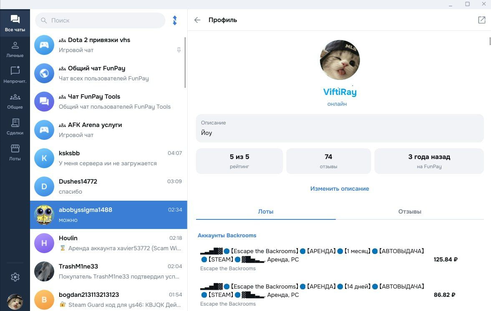
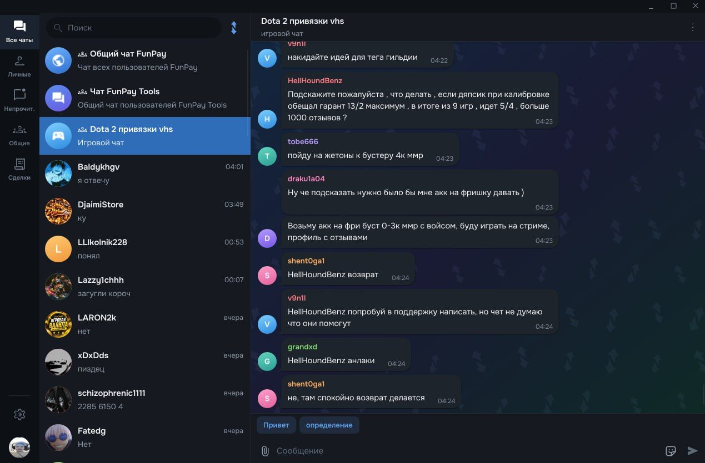
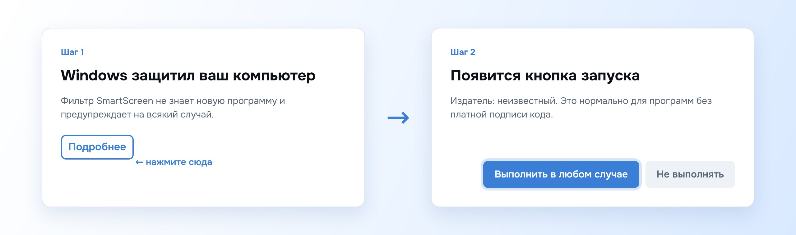

  

  

  
  
  

  
  

 

  

  

> [!WARNING]
> Программа работает напрямую с сайтом FunPay через ваш вход. Golden Key и куки хранятся **только** на вашем компьютере в `%APPDATA%\FunPayTools` и никуда не передаются.

---

### 💬 Чаты и переписка

*   **Папки**: все чаты, личные, непрочитанные, общие, архив и свои папки. Поиск по чатам
*   **Правый клик по чату**: закрепить, прочитано, без звука, в папку, в архив, открыть на FunPay
*   **Общий чат FunPay**, игровые чаты и общий чат пользователей FunPay Tools
*   **Видно, кто из собеседников тоже пользуется FunPay Tools**
*   **Ответы с цитатой**, закреплённое сообщение, выделение и копирование текста, `Ctrl+A/C/X/V` везде
*   **Кликабельные ссылки** и кнопка "Открыть заказ" под оповещениями FunPay
*   **Альбомы фото**, просмотр на весь экран, отправка с подписью через скрепку или `Ctrl+V`, стикеры

### ⚡ Шаблоны и ИИ

*   **Кнопки-шаблоны** над полем, под полем, полосой сверху или снизу, или меню у стикеров
*   **Свой вид**: форма, размер, заливка, выравнивание, цвет и картинка у каждой кнопки
*   **Переменные** `$username`, `$welcome`, `$lot_name`, `$order_id`, `$order_link`, `{buyername}` и другие
*   **Бинды** `Alt + цифра` и поиск шаблона через `/` в начале сообщения
*   **Переписать с ИИ**: правый клик по кнопке отправки превращает черновик в вежливый ответ с учётом переписки

  

### 📦 Сделки и финансы

*   **Продажи и покупки** с фильтром: оплачен, закрыт, возврат
*   **Экран заказа**: возврат, подтверждение, свой отзыв, ответ на отзыв с правкой и удалением
*   **Финансы**: операции, баланс и сумма "В заморозке"
*   **Лоты**: можно редактировать свои лоты и смотреть 

  

### 👤 Профили и аккаунты

*   **Профиль любого пользователя**: лоты, отзывы, рейтинг, описание и баннер
*   **Своё описание** правится прямо в программе
*   **Цветные ники донатеров** с градиентом и анимацией
*   **Несколько аккаунтов** с быстрым переключением

  

### 🔔 Уведомления и фон

*   **Свои окна уведомлений** в любом углу экрана: сколько сразу, имя, текст, значок. Или обычные уведомления Windows
*   **Звук** работает отдельно от всплывающих окон
*   **Трей и автозапуск**: крестик прячет окно, сообщения продолжают приходить

### 🎨 Интерфейс

*   **Светлая, тёмная или как в системе**, импорт своих тем `.tdesktop-theme` и `.attheme`
*   **Встроенный браузер** со вкладками для страниц FunPay
*   **Готовые темы** из расширения FunPay Tools взяли каталог тем и заснуули сюда
*   **Мгновенный запуск**: чаты сохраняются на компьютере и видны сразу
*   **Автообновление** с GitHub, ничего не нужно скачивать вручную

  

---

1. **Скачайте** `FunPayTools.exe` из [последнего релиза](../../releases/latest).
2. **Положите** его в любую папку, например `Документы\FunPay Tools`. Установщик не нужен.
3. **Запустите.** Если Windows покажет синее окно, смотрите блок ниже.
4. **Войдите** через браузер внутри программы или по Golden Key.
5. **Всё.** Дальше программа обновляется сама.

  

> [!TIP]
> Для входа через браузер нужен Microsoft Edge WebView2. В Windows 10 и 11 он почти всегда уже стоит. Если нет, программа сама подскажет войти по ключу.

---

> [!WARNING]
> При первом запуске Windows может показать окно **"Windows защитил ваш компьютер"**. Это фильтр SmartScreen: он предупреждает о любой новой программе без платного сертификата подписи кода. Вирусов в FunPay Tools нет и не было.

Нажмите **"Подробнее"**, потом **"Выполнить в любом случае"**. Это нужно один раз. Если антивирус ругается, добавьте файл в исключения.

---

*   🔐 Golden Key и куки лежат только в `%APPDATA%\FunPayTools\desktop.json` на вашем компьютере
*   🧾 Журнал ошибок в настройках не содержит ключей и паролей, они вырезаются
*   🔄 Обновления скачиваются только из этого репозитория, контрольная сумма файла проверяется

---

  
  
  
  

 

Проект делается на энтузиазме. Если программа помогает вам продавать, поставьте **Star** ⭐ и расскажите друзьям.

Нашли баг или есть идея? Создайте [**Issue**](../../issues) или напишите в [**Telegram**](https://t.me/fptools).

---

### ⚖️ Отказ от ответственности
*Программа не является официальным клиентом FunPay. Используйте на свой страх и риск.*

  

